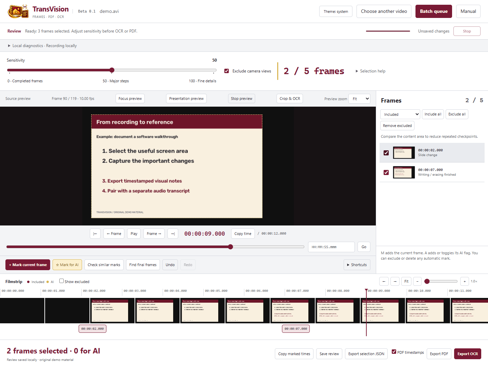

# TransVision

## What is TransVision?

TransVision saves selected frames from a recording as timestamped PDFs, PNG images, or an OCR text file. Use it for slides, handwritten work, code, diagrams and screen recordings.

## What it uses

The app runs locally in a browser and uses Python 3.12 or newer. OpenCV reads the video, RapidOCR or Tesseract reads text, and ReportLab/pypdf creates PDFs. Windows is the tested platform. No paid API is required.

## Install and use · Windows

1. Install **Python 3.12 or newer** from [python.org](https://www.python.org/downloads/windows/). Enable **Add Python to PATH** in the installer.
2. Download this repository with **Code → Download ZIP**, then extract it to a normal folder.
3. Double-click **Setup TransVision.cmd**. Keep internet connected while dependencies install.
4. Double-click **Start TransVision.cmd**. The app opens in a browser window.
5. Browse for a video, click **Preview video**, check its crop, then start detection. Select the frames you want and choose **Export PDF** or **Export OCR**. Use **Batch queue** for multiple recordings.

You do not need Node.js to run the app. PDF export works without OCR model downloads. OCR models may need internet on first use; afterward processing is local. Tesseract is an optional separate installation for the code profile and fallback OCR.

Closing the last app tab stops the local server. Use **Stop** to cancel a job while keeping the app open. The [manual](docs/MANUAL.md) covers settings, shortcuts, filenames and AI correction.

## Main features

- Preview, crop and trim before scanning.
- One sensitivity slider: completed frames, major steps or fine detail, with live frame counts.
- Manual frame selection and timestamped PDFs, split into parts of at most 100 pages.
- Batch queue: PDF, OCR or both; automatic export or review first; stop, pause, resume and retry.
- Choose an export folder for PDF and OCR: remember it, change it anytime, or ask before each export or batch run.
- Local OCR for plain text, plus AI-marked images and a correction prompt for complex content.
- Stop loading or processing; closing the last app tab shuts down its local server.

OCR is a draft. It works best for plain text; check complex text, equations and handwriting against the images. The [manual](docs/MANUAL.md#correct-complex-content-with-an-llm) explains the optional AI correction workflow.

## Partner: review(er)

[review(er)](https://github.com/Enerbonn/review-er) is a companion learning skill
for AI agents. Give it your TransVision exports and, optionally, a separate audio
transcript or lecture notes. **Review** mode helps you learn in short conversations
while building notes; **Reviewer** mode creates the document directly when time
is short. It asks about your learning goal, connects examples to it, and saves
local progress for the next session. No automatic app integration or upload is required.

PDF parts retain the video name: a 250-frame export from `lesson.mp4` produces
`lesson_01.pdf`, `lesson_02.pdf`, and `lesson_03.pdf` at the default 100-page limit.
Give the skill all relevant parts so it can follow source timestamps across them.

## Credits

**© 2026 Irvin John Parulan.** Based on [FrameRead by @pr1hm](https://github.com/pr1hm/FrameRead), originally published at [s-pra1ham/FrameRead](https://github.com/s-pra1ham/FrameRead). TransVision retains its [Apache 2.0 license](LICENSE); see [NOTICE](NOTICE).

I use [Buzz](https://github.com/chidiwilliams/buzz) ([website](https://chidiwilliams.github.io/buzz/)) for the audio transcript and TransVision for the slides and on-screen work. They are separate apps. Match their outputs using the video timestamps.

Thanks to OpenCV/OpenCV Zoo, RapidOCR/PaddleOCR, ONNX Runtime, Tesseract, ReportLab and pypdf. Libraries and bundled models retain their own licenses.

## PS

Yep, this was vibe-coded. Claude Code helped early on; most of the work was done in Codex. I built it because I needed the visual parts of my lectures, and Linear Algebra was not going to review itself lol. I still plan to work through the code manually. This is a beta, so bug reports and suggestions are welcome. :)
